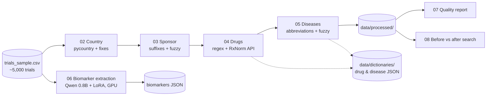

<h1 align="center">🧬 Clinical Trial Data Harmonization & Biomarker Extraction</h1>
<p align="center">Turning ~5,000 messy ClinicalTrials.gov records into clean, searchable data, then extracting biomarkers with a small LLM.<br/>
<b>Python · pandas · RxNorm API · fuzzy matching · Hugging Face Transformers · LoRA (PEFT)</b></p>

---

## Problem

ClinicalTrials.gov data is entered by thousands of sponsors with no shared vocabulary. The same drug, disease, company or country appears under many spellings ("Avastin" vs. "Bevacizumab", "NSCLC" vs. "Non-Small Cell Lung Cancer", "USA" vs. "United States"). A researcher searching for a drug or disease silently misses part of the trials, and biomarkers are buried in free text.

## Solution

A step-by-step Python pipeline that cleans and harmonizes 4 key fields (country, sponsor, drug, disease) with dictionaries, external references and safe fuzzy matching, measures the before/after quality, and runs a LoRA fine-tuned Qwen 0.8B model to extract biomarker names from trial text as JSON.

**Results:** 233 duplicate disease names merged, 47 brand names mapped to generics, 130 clean countries, and a working biomarker extractor (~7.9 s/trial on a T4 GPU, ~6% JSON parse failures).

## Architecture



## How the workflow runs

Each script reads the output of the previous one, so every step can be inspected and re-run on its own:

| Step | Script | Input → Output |
|---|---|---|
| 1 | `src/01_explore.py` | Profile columns, missing values and messiness |
| 2 | `src/02_harmonize_country.py` | `raw/trials_sample.csv` → `processed/trials_country_cleaned.csv` |
| 3 | `src/03_harmonize_sponsor.py` | → `processed/trials_sponsor_cleaned.csv` |
| 4 | `src/04_harmonize_drugs.py` | → `processed/trials_drugs_cleaned.csv` + drug dictionary |
| 5 | `src/05_harmonize_diseases.py` | → `processed/trials_conditions_cleaned.csv` + disease dictionary |
| 6 | `src/06_biomarker_extraction_kaggle.py` | Trial text → biomarkers (GPU, Kaggle) |
| 7 | `src/07_quality_metrics.py` | Before/after report → `outputs/quality_report.txt` |
| 8 | `src/08_stretch_goal.py` | Shows how many more trials a search finds after cleaning |

## How to run

The raw dataset is not committed. Put `trials_sample.csv` in `data/raw/`, then:

```bash
git clone https://github.com/OussemaBouchaala/Clinical-Trial-Data.git
cd Clinical-Trial-Data
python -m venv venv && source venv/bin/activate   # Windows: venv\Scripts\activate
pip install -r requirements.txt
mkdir -p data/processed

python src/02_harmonize_country.py
python src/03_harmonize_sponsor.py
python src/04_harmonize_drugs.py      # calls the RxNorm API, ~10 min
python src/05_harmonize_diseases.py
cp data/processed/trials_conditions_cleaned.csv data/processed/trials_cleaned.csv
python src/07_quality_metrics.py
python src/08_stretch_goal.py
```

No time to run it? The final numbers are in [`outputs/quality_report.txt`](outputs/quality_report.txt) and the table below.

Biomarker extraction (step 6) needs a GPU with at least 3 GB of VRAM; it was run on Kaggle (2× T4).

## Project structure

```
├── src/                 # Pipeline steps 01 → 08
├── notebooks/           # Exploration and biomarker notebooks (local + Kaggle)
├── data/
│   ├── raw/             # trials_sample.csv (not committed)
│   ├── processed/       # Cleaned CSVs (generated)
│   └── dictionaries/    # drug_dictionary.json, disease_dictionary.json
├── outputs/             # quality_report.txt
└── requirements.txt
```

## Approach per Field

### 1. Country
**Tool:** `pycountry` library + manual pre-fix/post-fix dictionaries.
**How:** pycountry maps messy names ("USA", "Brasil", "Turkey (Türkiye)") to official names, but returns ugly forms like "Iran, Islamic Republic of". So we added a post-fix layer to convert those to common names ("Iran", "Vietnam", "Russia"). Special handling for comma-containing country names (e.g., "Korea, Republic of") which broke naive comma-splitting.
**Result:** 439 → 438 unique combinations, 130 clean individual countries, 0 broken fragments.

### 2. Sponsor
**Tool:** Regex suffix standardization + core name extraction + fuzzy matching (`thefuzz`, threshold 90, pharma/biotech only).
**How:** Three layers: (1) manual map for edge cases (e.g., "Pfizer's Upjohn has merged with Mylan..." → "Viatris Inc"), (2) standardize legal suffixes (Inc., Incorporated, Corporation → consistent forms), (3) fuzzy match pharma companies only (skip universities/hospitals to avoid false merges like "Cairo University" ≠ "Cairo University Hospital").
**Result:** 2517 → 2507 unique sponsors. 731 rows suffix-standardized, 5 groups merged (8 remaps).

### 3. Drug / Intervention
**Tool:** Regex cleaning (strip dosages, pharmaceutical forms) + RxNorm API (NIH) for brand→generic mapping.
**How:** First strip dosage info ("Aspirin 81mg" → "Aspirin"), normalize casing, then query RxNorm for INN-suffix drug names and common brands to get canonical generic names. Combo cells ("Pembrolizumab + Carboplatin") preserved as combos — each drug cleaned individually within the cell.
**Result:** 4924 → 4875 unique values. Dictionary: 387 entries (47 brand→generic like Avastin→Bevacizumab, 340 casing fixes). RxNorm API: 460 calls, ~10 min.
**Limitations:** Research codes (MK-3475) not mapped — would need manual curation or additional database. Combo cells stay unique by design (different trial designs).

### 4. Disease / Condition
**Tool:** Hybrid — manual abbreviation dictionary (~45 entries) + casing normalization + plural stripping + British→American spelling + fuzzy matching (`thefuzz`, threshold 95).
**How:** Conditions are pipe-separated. We expand abbreviations (NSCLC → Non-Small Cell Lung Cancer, ADHD → Attention Deficit Hyperactivity Disorder), normalize casing while preserving medical acronyms, strip plurals ("Diseases" → "Disease"), convert British spelling ("Leukaemia" → "Leukemia"), then fuzzy match remaining near-duplicates at a high threshold to avoid false merges.
**Result:** 5124 → 4891 individual conditions (reduced by 233). Condition cells: 3663 → 3561. Fuzzy matching contributed 49 safe merges.

### 5. Biomarker Extraction
**Model:** `Shubh-0789/biomarker-qwen3.5-0.8b-lora-v2.1` — fine-tuned Qwen3.5-0.8B with LoRA adapter, loaded via `transformers` + `peft`.
**How:** For each trial, concatenated brief_title + official_title + primary_outcome + secondary_outcome into one text block. Fed to the model with the prompt: "Extract all biomarker names from the following clinical text. Return ONLY a JSON." Parsed JSON output, deduplicated biomarkers (case-insensitive), capped at 20 per trial to prevent hallucination loops.

**Infrastructure challenges (transparent account):**
- Local GPU (2GB VRAM) insufficient for the 0.8B model → moved to Kaggle (T4 GPU, 16GB VRAM)
- Kaggle had `transformers==5.0.0` pre-installed; Qwen3.5 requires `>=5.2.0`. Standard pip upgrade failed due to Kaggle environment pinning. Fix: manually deleted the old package (`rm -rf`) and reinstalled
- The model wraps JSON output in markdown backticks (```json ... ```), which broke `json.loads()`. Fixed with regex stripping + trailing comma handling
- The model sometimes returns plain lists `[]` instead of the documented dict format `{"biomarkers": [...]}`. Parser handles both
- Attempted dual-GPU parallel processing (T4 x2) using threading — both GPUs active, processing 2500 trials each
- **Kaggle session disconnected due to internet issues** after ~250/2500 trials per GPU (~37 min elapsed). Environment reset on reconnect, losing all outputs and requiring full reinstall. Checkpoint files were saved to disk but not downloaded before disconnect
- On successful runs: ~6% JSON parse failure rate, ~7.9 sec/trial, estimated ~5.5 hours total for dual-GPU approach

**What the working code does:**
- Loads base model (Qwen3.5-0.8B, bfloat16) + LoRA adapter on GPU
- Single-trial inference loop with greedy decoding (do_sample=False) for speed
- Robust JSON parser: strips markdown fences, fixes trailing commas, handles both list and dict formats
- Deduplication: case-insensitive, max 20 biomarkers per trial
- Progress logging every 50 trials, checkpoints every 500

## Quality Metrics Summary

| Field | Unique Before | Unique After | Reduction | Method |
|-------|--------------|-------------|-----------|--------|
| Country (combinations) | 439 | 438 | 1 | pycountry + manual fixes |
| Country (individual) | ~150+ | 130 | standardized | pycountry + pre/post-fix |
| Sponsor | 2517 | 2507 | 10 | suffix normalization + fuzzy |
| Drug/Intervention | 4924 | 4875 | 49 | regex + RxNorm API |
| Disease (individual) | 5124 | 4891 | 233 | abbreviations + fuzzy |
| Disease (cells) | 3663 | 3561 | 102 | same |
| Biomarkers | — | — | incomplete | Kaggle crash (code functional) |

## Trade-offs

| Decision | What we chose | Alternative | Why |
|----------|--------------|-------------|-----|
| Drug lookup | RxNorm API (INN-suffix only) | Query all 4924 names | Time: 460 calls took 10 min; 4924 would take 1.5 hours |
| Sponsor fuzzy | Pharma only, threshold 90 | All sponsors, lower threshold | Risk of false merges for institutions |
| Disease fuzzy | Threshold 95 | Lower threshold | Medical terms are precise — "Breast Cancer" ≠ "Brain Cancer" |
| Biomarker batching | Simple loop (1 at a time) | Batched inference | PEFT + transformers 5.2 broke batch tokenization; simple loop was reliable |
| Biomarker speed | Dual-GPU threading | Single GPU | Cut estimated time from ~11h to ~5.5h |

## What I'd Improve with More Time

1. **Biomarker completion** — re-run on a stable environment (Colab Pro, cloud GPU) with checkpoint resume
2. **Drug research codes** — build a manual map for codes like MK-3475 → Pembrolizumab using ClinicalTrials.gov API
3. **Disease ontology** — integrate MeSH API for hierarchical disease mapping (e.g., NSCLC as a child of Lung Cancer)
4. **Sponsor deduplication** — extend fuzzy matching to institutions with stricter rules
5. **Biomarker validation** — sample 100 results manually to measure precision/recall of the model
6. **Batched inference** — debug tokenizer padding issue in transformers 5.2 for proper batch generation

## Tools & Libraries Used
- Python 3.12, pandas, pycountry, thefuzz, regex
- RxNorm API (NIH) for drug name resolution
- transformers (5.2.0), peft, torch — for biomarker model
- Kaggle (GPU T4 x2) for inference
- Claude AI — used as a coding assistant for all steps. Every approach and decision was discussed and understood before implementation.